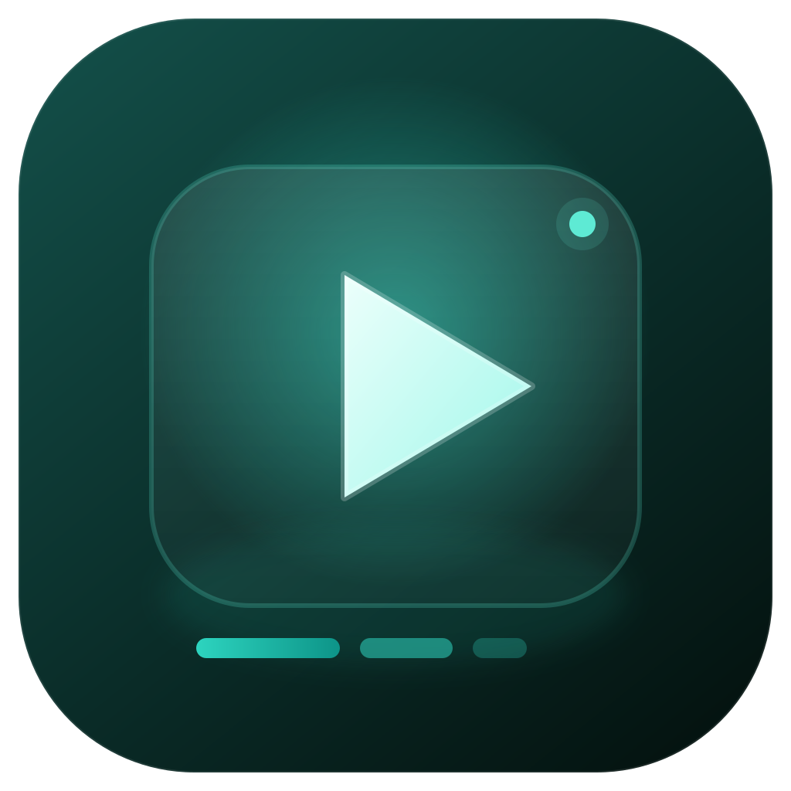
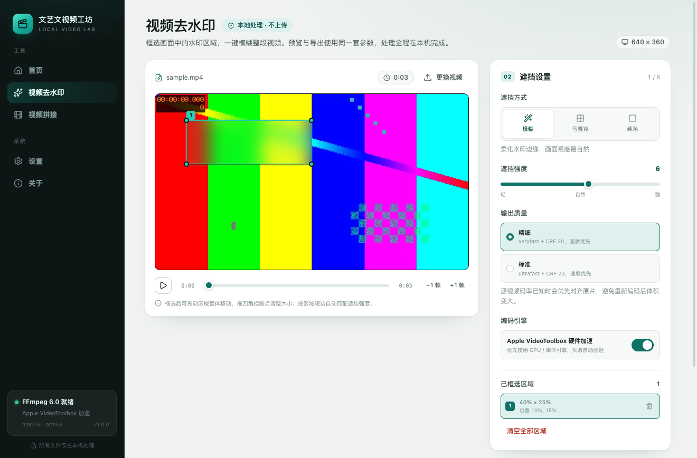
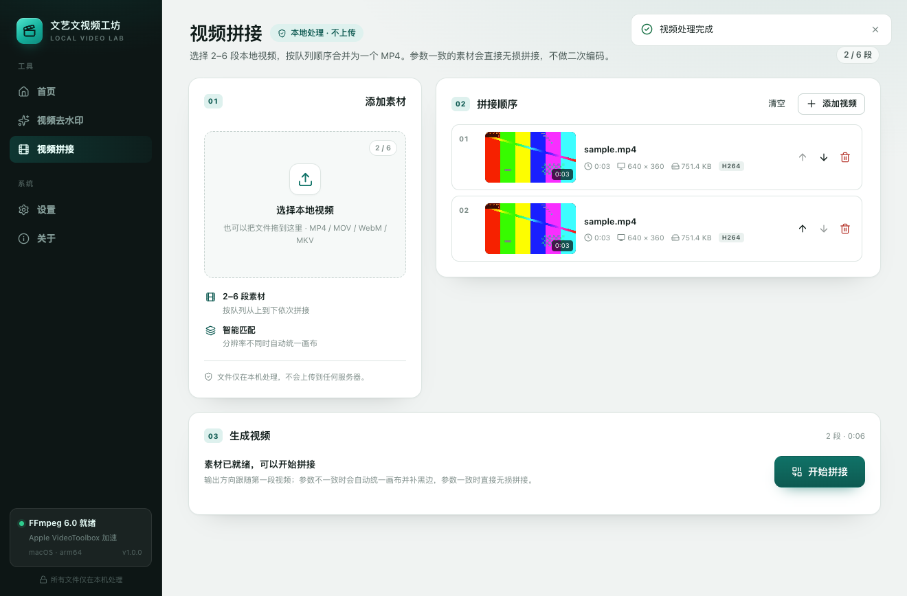
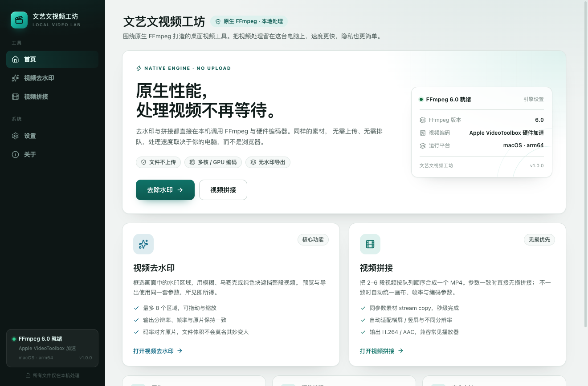
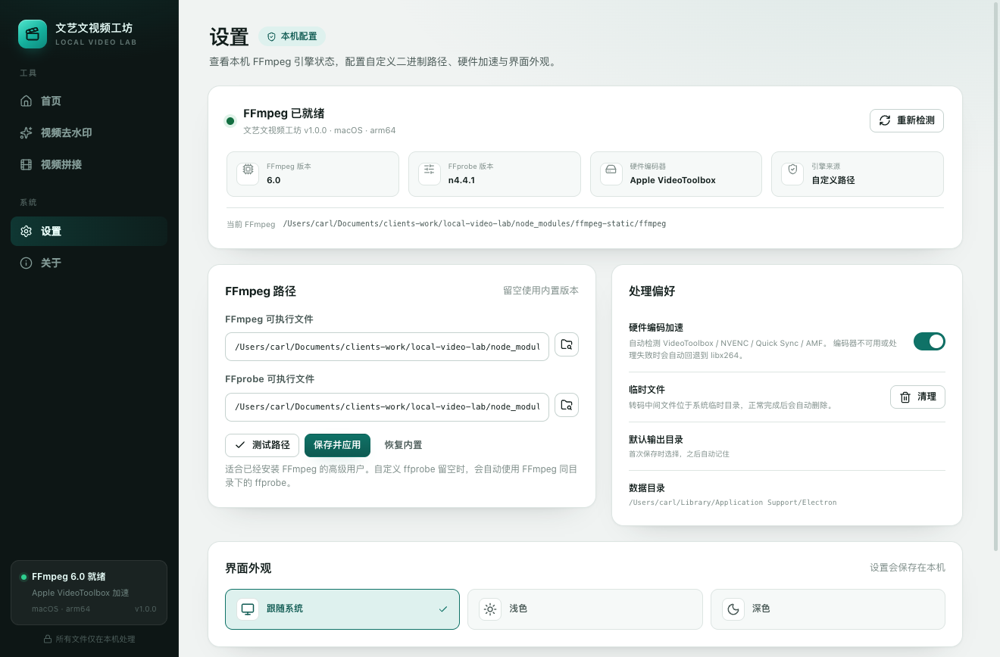

# Local Video Lab

<div align="center">
  
  <p><strong>Native FFmpeg desktop video tools — everything stays on your machine.</strong></p>
  <p>
    
    
    
    
  </p>
</div>

> **[简体中文](README.md) | English**

Local Video Lab is a cross-platform desktop app built around the **native FFmpeg** executable. The first release includes **watermark blurring** (the core feature) and **video joining**. No uploads, no accounts, no cloud queue — just local CPU/GPU.

The browser version used FFmpeg WebAssembly, which is single-threaded, memory-constrained, and cannot use hardware encoders. This app spawns native FFmpeg instead, uses all available cores, and prefers VideoToolbox / NVENC / Quick Sync / AMF when available.

## Features

### Watermark Blur (core)
- Draw up to 8 regions on the video frame.
- Blur (gaussian), mosaic (nearest-neighbor), or solid color.
- Real-time Canvas preview using the same parameters as the final FFmpeg filter graph.
- Frame stepping, playback, scrubbing.
- Keeps the source resolution and frame rate; aligns output bitrate to the source; copies compatible audio streams.
- Hardware encoding with automatic software fallback.

### Video Joiner
- Join 2–6 local clips into one MP4.
- **Lossless fast path**: identical H.264 parameters → concat + stream copy (no re-encode).
- **Automatic normalization**: different resolutions / orientations / audio → scale, pad, unify to H.264/AAC 30fps at max 1280×720 (or 720×1280 portrait), then merge losslessly.
- Reorder, remove, drag & drop; duplicate sources are transcoded once.

### Desktop & Privacy
- Native FFmpeg child process, progress parsed from `-progress pipe:1`, cancellable.
- Atomic output: a failed or cancelled job never destroys an existing file.
- Fully offline: no telemetry, no upload endpoints, no remote content.
- Sandboxed renderer + context isolation + whitelist `media://` protocol.
- Light / dark / system theme.

## Screenshots

| Watermark blur (core) | Video joiner |
| --- | --- |
|  |  |

| Home | Settings |
| --- | --- |
|  |  |

## Download

Grab an installer from the repository's **Releases** page (macOS 13+, Windows 10/11 x64):

- macOS Apple Silicon: `local-video-lab-*-mac-arm64.dmg`
- macOS Intel: `local-video-lab-*-mac-x64.dmg`
- Windows x64: `local-video-lab-*-win-x64.exe`

Builds are currently unsigned. On macOS, right-click → Open, or run:

```bash
xattr -dr com.apple.quarantine "/Applications/Local Video Lab.app"
```

On Windows, choose **More info → Run anyway** if SmartScreen appears.

## Development

Requirements: Node.js ≥ 22.12, npm ≥ 10.

```bash
git clone https://github.com/your-name/local-video-lab.git
cd local-video-lab
npm install
npm run dev
```

Useful commands:

```bash
npm test            # unit tests (Node test runner)
npm run test:smoke  # real FFmpeg: join + blur modes
npm run test:e2e    # Electron production build, preload, media://, canvas
npm run test:ui     # full UI flow: add files, draw region, process, verify output
npm run screenshots # regenerate docs screenshots
npm run icons       # build/icon.svg → icon.png
```

## Packaging

```bash
npm run dist:mac:arm64   # Apple Silicon DMG + ZIP
npm run dist:mac:x64     # Intel DMG + ZIP
npm run dist:win         # Windows NSIS (run on Windows or CI)
```

Artifacts go to `release/`. Cross-platform builds stage the matching FFmpeg/FFprobe binaries automatically. Building the Windows NSIS installer on Apple Silicon requires Rosetta (the bundled `makensis` is x86_64); the included GitHub Actions workflow builds it on a native Windows runner.

After packaging, verify the bundled engine:

```bash
"/path/to/Local Video Lab.app/Contents/MacOS/Local Video Lab" --self-test
```

## How it works

```text
Vue renderer (sandboxed)
   │  contextBridge whitelist API
   ▼
Electron main process
   ├─ validate params, ffprobe, build filter graph
   ├─ spawn native ffmpeg  → multi-core / hardware encoding
   ├─ parse -progress pipe:1 → IPC progress
   └─ atomic temp output → rename on success
   ▲
   └─ media:// protocol (Range + CORS) for <video> preview
```

See [docs/ARCHITECTURE.md](docs/ARCHITECTURE.md) for the full design, filter graph details, and constraints.

## Documentation

- [Usage guide (Chinese)](docs/USAGE.md)
- [Build & release (Chinese)](docs/BUILD.md)
- [Architecture (Chinese)](docs/ARCHITECTURE.md)
- [FAQ (Chinese)](docs/FAQ.md)
- [Contributing](CONTRIBUTING.md)
- [Changelog](CHANGELOG.md)

## License

GPL-3.0-or-later. Bundled FFmpeg/FFprobe binaries are distributed under their own GPL terms; see [THIRD_PARTY_NOTICES.md](THIRD_PARTY_NOTICES.md). You can replace the engine with your own FFmpeg build via **Settings → FFmpeg path**.

## Credits

FFmpeg, Electron, Vue, Vite, Lucide, electron-builder. Originally ported from the browser-based `cuntuweb-v2` video modules and redesigned around native FFmpeg.
