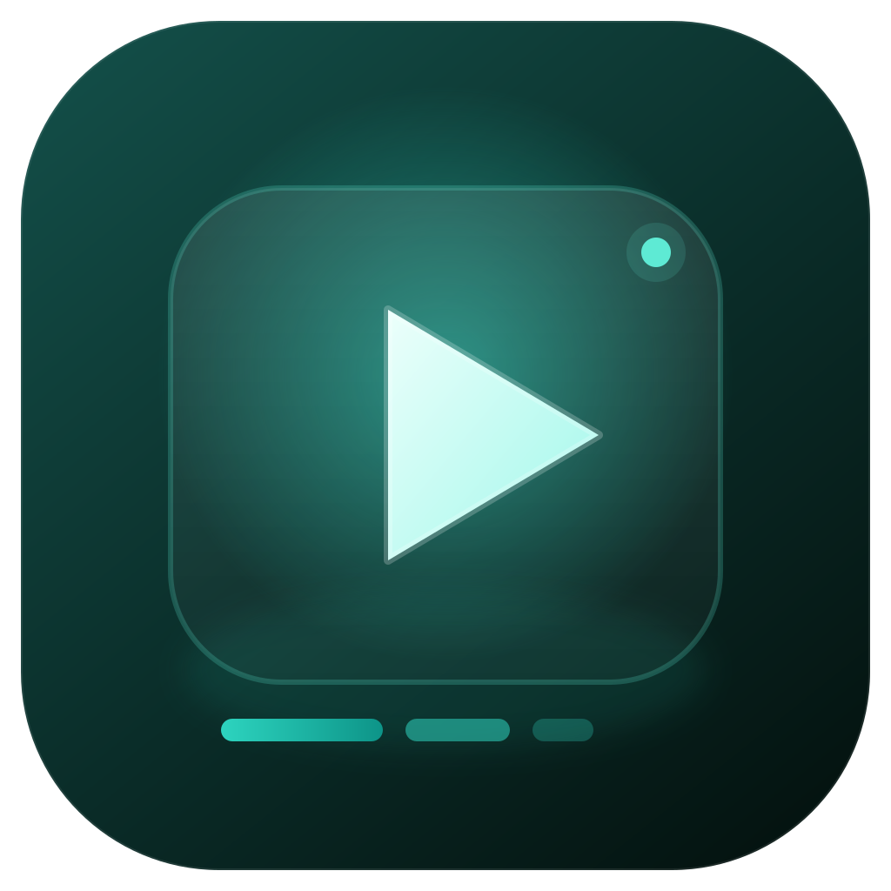
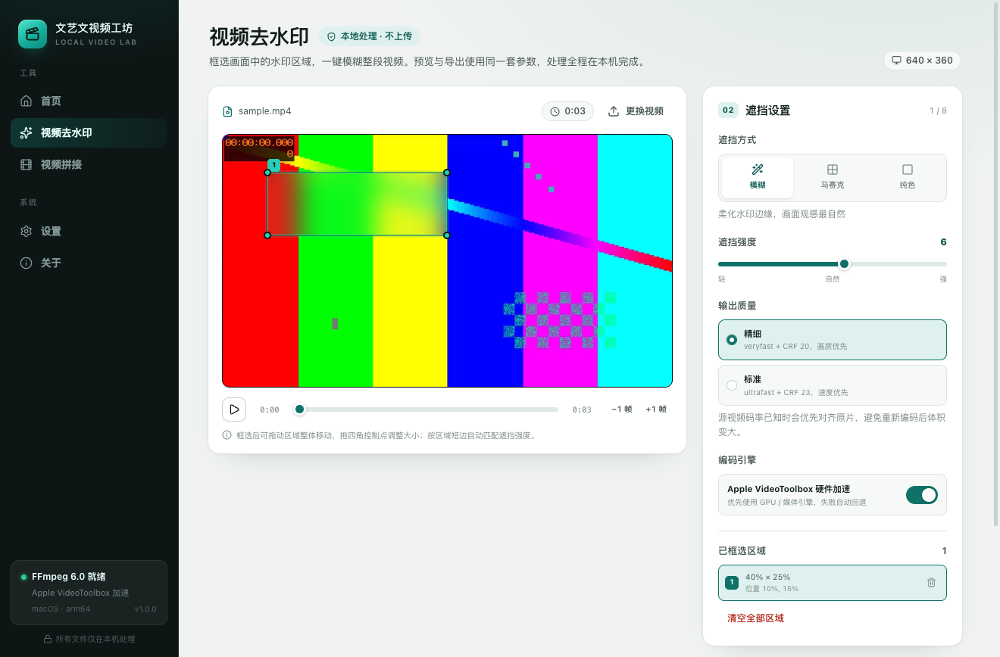
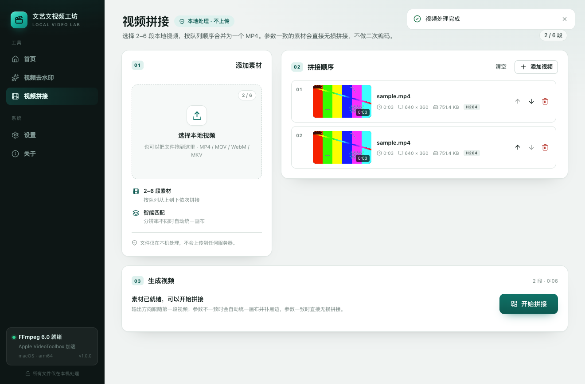
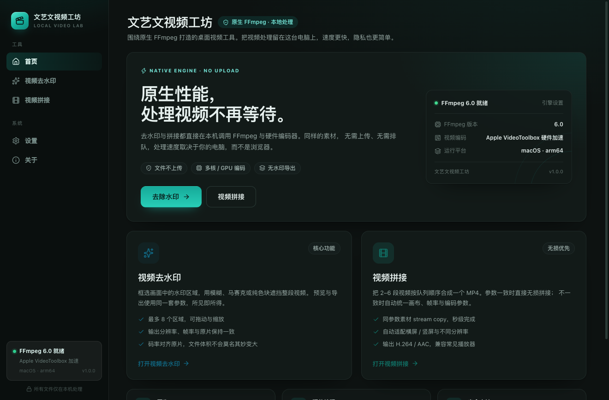
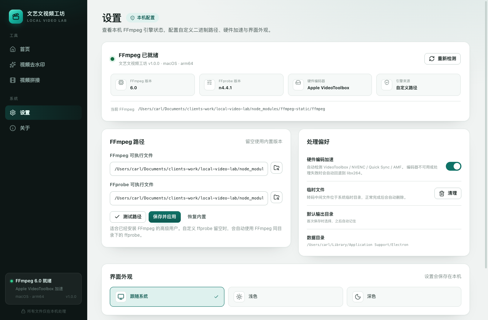
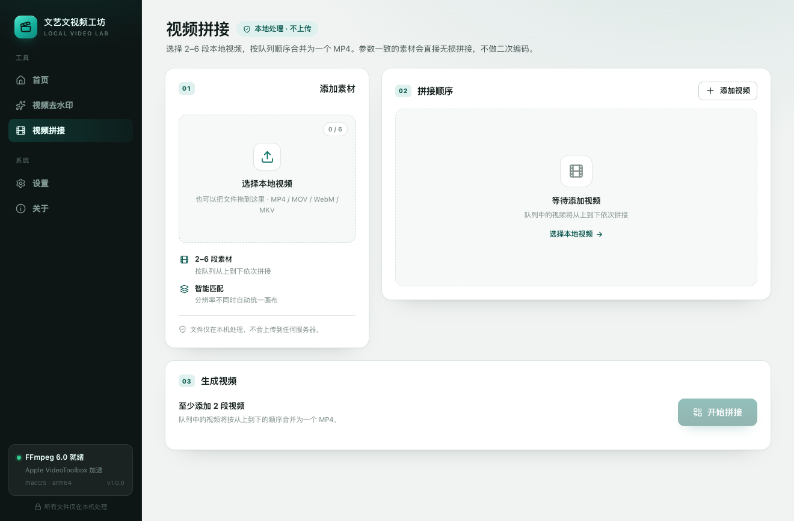
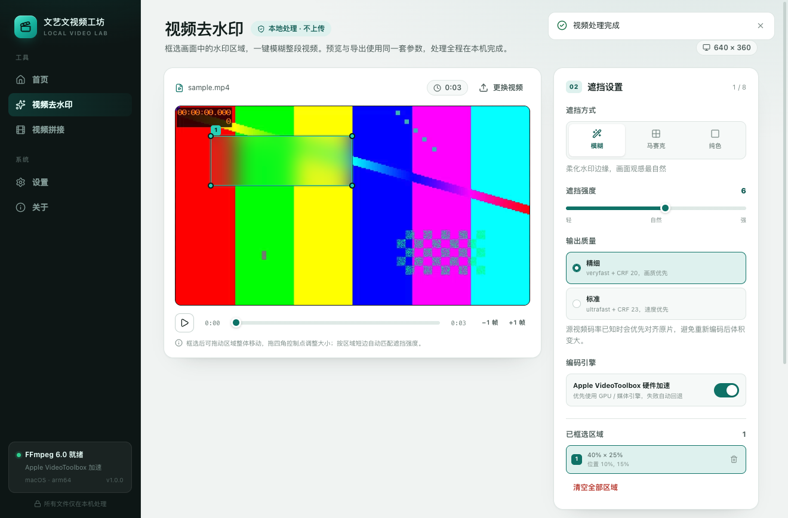
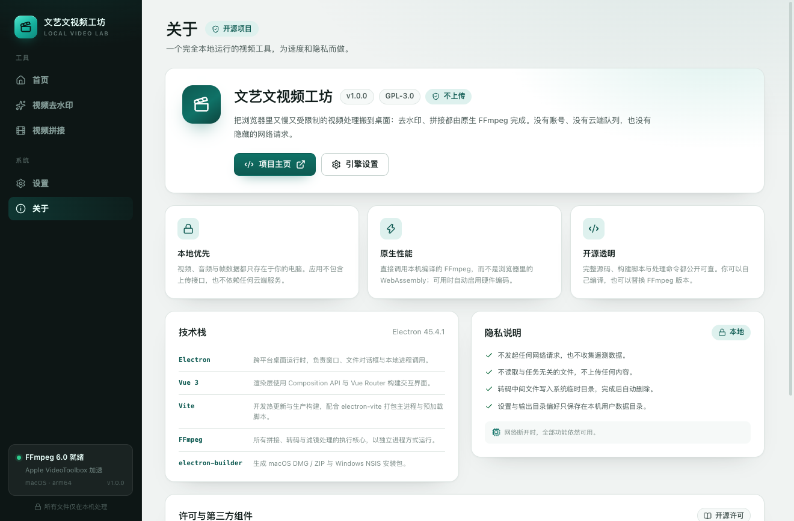

<div align="center">
  
  <h1>文艺文视频工坊 · Local Video Lab</h1>
  <p>基于原生 FFmpeg 的桌面视频工具：视频去水印、视频拼接。<br />所有处理都在你的电脑上完成，视频永远不会被上传。</p>

  <p>
    
    
    
    
  </p>
</div>

**[简体中文](README.md) | [English](README.en.md)**

> **为什么做这个项目？** 网页版视频工具依赖浏览器里的 FFmpeg WebAssembly，速度慢、内存受限，长视频经常卡死或崩溃。这个桌面版直接调用本机编译好的 FFmpeg，并优先使用 VideoToolbox / NVENC / Quick Sync / AMF 等硬件编码器，把处理速度交还给你的电脑。

---

## 目录

- [功能](#功能)
- [截图](#截图)
- [下载与安装](#下载与安装)
- [从源码运行](#从源码运行)
- [构建安装包](#构建安装包)
- [测试](#测试)
- [工作原理](#工作原理)
- [项目结构](#项目结构)
- [隐私与安全](#隐私与安全)
- [FFmpeg 与开源许可](#ffmpeg-与开源许可)
- [常见问题](#常见问题)
- [文档](#文档)
- [贡献](#贡献)

---

## 功能

### 视频去水印（核心功能）

框选画面中的水印区域，对整段视频应用遮挡。

- **三种遮挡方式**：模糊（高斯）、马赛克（最近邻像素块）、纯色块。
- **最多 8 个区域**，可拖动、四角缩放、单独删除；按区域短边自动匹配遮挡强度。
- **实时预览**：Canvas 2D 逐帧绘制，参数与最终 FFmpeg 滤镜一致，所见即所得。
- **逐帧定位**：拖动进度条、播放/暂停、前后 ±1 帧。
- **保持原片参数**：输出分辨率与帧率不变；已知源码率时按源码率编码，避免“处理完文件反而更大”。
- **音频优先 copy**：AAC / MP3 / AC3 / EAC3 / ALAC 直接复制，其他转 AAC。

### 视频拼接

把 2–6 段本地视频按队列顺序合并为一个 MP4。

- **无损快速拼接**：所有素材都是 H.264 且分辨率、像素格式、帧率、音轨参数一致时，直接 `stream copy`，不重新编码，画质不变、速度极快（实测 2 段 24 秒视频约 0.04 秒完成）。
- **自动标准化**：参数不一致（包括横屏 + 竖屏、有无音轨）时，以第一段视频方向确定输出画布（长边 1280 / 短边 720），逐段等比缩放、补黑边，统一为 H.264 / AAC / 30fps 后再无损合并。
- **队列编辑**：添加、删除、上移、下移；支持拖拽文件到窗口。
- **重复素材复用**：A-B-A 这类顺序只会转码一次，其余直接复用中间结果。

### 共同特性

- **原生 FFmpeg 子进程**：不受浏览器 WASM 的单线程/内存限制。
- **硬件编码**：启动时用真实小视频逐项检测编码器是否真的可用，失败自动回退 `libx264`；可在设置中关闭。
- **原子输出**：先写隐藏临时文件，成功后才替换目标文件。取消或失败不会破坏你原有的同名文件。
- **可取消**：取消会终止 FFmpeg 子进程并清理中间文件。
- **完全离线**：没有账号、云端队列、上传接口或遥测。

---

## 截图

| 视频去水印（核心） | 视频拼接 |
| --- | --- |
|  |  |

| 首页 | 设置 |
| --- | --- |
|  |  |

<details>
<summary>更多截图（上传状态、处理结果、关于页、深色主题）</summary>

| 视频拼接（初始） | 去水印结果 |
| --- | --- |
|  |  |

| 关于 | 深色主题 |
| --- | --- |
|  |  |

</details>

> 截图由 `npm run screenshots` 与 `npm run test:ui` 使用 Electron 生产构建自动生成。

---

## 下载与安装

前往仓库的 **Releases** 页面下载对应安装包：

| 平台 | 文件 | 说明 |
| --- | --- | --- |
| macOS Apple Silicon（M1/M2/M3/M4…） | `local-video-lab-*-mac-arm64.dmg` | 推荐 |
| macOS Intel | `local-video-lab-*-mac-x64.dmg` | 适用于 Intel 芯片 |
| Windows 10/11 x64 | `local-video-lab-*-win-x64.exe` | NSIS 安装包 |

每个 macOS 版本同时提供 `.zip`，适合不想使用 DMG 或需要便携解压的场景。

### macOS 首次打开

当前发布包默认**未签名、未公证**。首次打开可能提示“无法验证开发者”或“应用已损坏”。任选一种方式：

1. 在 Finder 中右键应用 → **打开** → 再次确认打开。
2. 或在终端执行：

```bash
xattr -dr com.apple.quarantine "/Applications/Local Video Lab.app"
```

### Windows 首次打开

安装包未做代码签名，SmartScreen 可能提示“Windows 已保护你的电脑”。点击 **更多信息 → 仍要运行** 即可。企业环境请自行签名，详见 [docs/BUILD.md](docs/BUILD.md)。

### 系统要求

- macOS 13 及以上（Electron 45 的系统要求；Intel / Apple Silicon 分别提供安装包）
- Windows 10 / 11（x64）
- 建议至少 4GB 可用内存；处理 4K 或超长视频时建议 8GB 以上

---

## 从源码运行

### 环境要求

- **Node.js ≥ 22.12**（推荐 Node 22 LTS 或更高）
- **npm ≥ 10**
- macOS / Windows（Linux 可开发运行，但第一版未提供正式安装包）

### 安装与开发

```bash
git clone https://github.com/your-name/local-video-lab.git
cd local-video-lab

npm install
npm run dev
```

`npm install` 会下载当前平台的 FFmpeg / FFprobe 静态二进制（开发与测试使用）；应用安装包中的二进制会在打包阶段重新按目标平台准备。

### 常用命令

| 命令 | 作用 |
| --- | --- |
| `npm run dev` | 启动 Vite + Electron 开发模式（热更新） |
| `npm run build` | 构建主进程、preload 与渲染层到 `out/` |
| `npm run preview` | 用生产构建预览 |
| `npm test` | 运行纯函数单元测试（Node 内置测试器） |
| `npm run test:smoke` | 生成测试视频，真实执行拼接与三种去水印模式 |
| `npm run test:e2e` | 在 Electron + 生产构建中验证 IPC、media 协议、Canvas 预览 |
| `npm run test:ui` | 自动走完整 UI 流程：选视频 → 框选 → 处理 → 校验输出 |
| `npm run screenshots` | 自动生成 `docs/screenshots` 界面截图 |
| `npm run icons` | 从 `build/icon.svg` 生成 1024×1024 应用图标 |

---

## 构建安装包

> 详细的构建、签名、CI 与发版说明见 **[docs/BUILD.md](docs/BUILD.md)**。

### macOS

```bash
# Apple Silicon
npm run dist:mac:arm64

# Intel
npm run dist:mac:x64
```

产物位于 `release/`：

- `local-video-lab-<version>-mac-arm64.dmg` / `.zip`
- `local-video-lab-<version>-mac-x64.dmg` / `.zip`

在 Apple Silicon 上交叉打 x64 包时，打包钩子会自动下载 x86_64 的 FFmpeg / FFprobe；**不支持 universal 单包**，请分别发布 arm64 与 x64。

### Windows

建议在 Windows 上构建（或在 CI 的 `windows-latest` 上构建）：

```powershell
npm ci
npm run dist:win
```

产物：`release/local-video-lab-<version>-win-x64.exe`。

在 macOS / Linux 上交叉打 Windows 包时，FFmpeg 二进制会按目标平台自动下载；但 NSIS 的 `makensis` 是 x86_64 工具，Apple Silicon 需要安装 Rosetta 才能本地生成安装器。更推荐直接使用仓库内置的 GitHub Actions（`windows-latest` runner）。

### 打包做了什么

1. `electron-vite build` 生成 `out/main`、`out/preload`、`out/renderer`。
2. `scripts/before-pack.cjs` 按目标平台/架构准备 FFmpeg 与 FFprobe，放到 `build/staged-bin`（缓存于 `.cache/binaries`）。
3. `electron-builder` 把它们复制到应用包的 `resources/bin`，并生成 DMG / ZIP / NSIS。
4. 应用启动时优先使用 `resources/bin` 中的二进制；开发环境回退到 `node_modules`。

### 验证安装包

打包后可直接运行无界面自检：

```bash
# macOS
"/path/to/Local Video Lab.app/Contents/MacOS/Local Video Lab" --self-test

# Windows（在安装目录或从开始菜单打开终端）
"Local Video Lab.exe" --self-test
```

输出会包含 FFmpeg / FFprobe 路径、版本和检测到的硬件编码器。`"ok": true` 表示安装包内的引擎可用。

---

## 测试

```bash
npm test            # 28 个纯函数单元测试
npm run test:smoke  # 真实 FFmpeg：无损拼接、标准化拼接、模糊/马赛克/纯色
npm run test:e2e    # Electron 生产构建 + media:// + canvas + preload API
npm run test:ui     # 真实 UI 流程：自动添加素材、框选区域、点击处理并校验输出
```

`test:smoke` 会生成横屏、竖屏、无音轨的测试素材，并校验输出分辨率、音轨与编码格式；`test:e2e` 会确认自定义协议支持 Range/seek，且 Canvas 没有被跨域污染（去水印框选依赖这一点）；`test:ui` 会驱动实际界面完成一次去水印和一次无损拼接。

---

## 工作原理

```text
┌──────────────────────────── 渲染进程（Vue 3） ────────────────────────────┐
│  工具页面 · 区域框选 · Canvas 实时预览 · 进度/结果 UI                      │
│            │ window.api（contextBridge 白名单）                            │
└────────────┼───────────────────────────────────────────────────────────────┘
             │ IPC
┌────────────▼──────────────── 主进程（Electron） ───────────────────────────┐
│  job manager ──> 参数校验 / ffprobe 探测 / 滤镜图拼接                        │
│        │                                                                   │
│        ├──> spawn(ffmpeg, args)  ← 原生可执行文件，多核 / 硬件编码           │
│        ├──> -progress pipe:1     → 真实进度 IPC                             │
│        └──> 原子写入临时文件 ──成功后 rename──> 用户选择的目标文件           │
│                                                                            │
│  media:// 自定义协议：Range + CORS，供 <video> 预览本地文件                 │
└────────────────────────────────────────────────────────────────────────────┘
```

- 渲染层只负责交互与预览，不接触文件系统或子进程。
- 所有 FFmpeg 参数都在主进程构造，避免渲染层直接拼命令。
- 预览通过 `media://local/<encoded-path>` 读取任意本地视频；协议只放行音视频扩展名，并支持 HTTP Range（拖动进度条、逐帧定位）。
- 架构细节与滤镜图说明见 [docs/ARCHITECTURE.md](docs/ARCHITECTURE.md)。

---

## 项目结构

```text
local-video-lab/
├── electron.vite.config.mjs      # 主进程 / preload / 渲染层构建配置
├── electron-builder.yml          # 安装包配置（DMG / ZIP / NSIS）
├── scripts/
│   ├── before-pack.cjs           # 按目标平台准备 FFmpeg / FFprobe
│   ├── e2e-electron.cjs          # Electron 端到端检查
│   ├── smoke-test.cjs            # 真实 FFmpeg 冒烟测试
│   ├── screenshots.cjs           # 自动截图
│   └── generate-icon.mjs         # SVG → PNG 图标
├── src/
│   ├── main/                     # 主进程
│   │   ├── ffmpeg/               # 探测、滤镜、拼接/去水印任务、硬件编码
│   │   ├── jobs.js               # 单任务管理、进度、取消
│   │   ├── mediaProtocol.js      # media://（Range + CORS）
│   │   ├── settings.js           # 本机设置
│   │   └── index.js              # 窗口、菜单、IPC
│   ├── preload/index.js          # contextBridge 白名单 API
│   └── renderer/src/             # Vue 3 界面
├── docs/                         # 使用、构建、架构、FAQ
├── tests/                        # 纯函数单元测试
└── build/                        # 图标与打包资源
```

---

## 隐私与安全

- **不上传**：项目没有任何上传接口、云端服务或遥测代码。
- **不联网**：应用运行时不发起网络请求，网络断开时全部功能可用。
- **最小权限**：`sandbox: true` + `contextIsolation: true`，渲染层只能调用 preload 暴露的白名单方法。
- **文件访问受限**：`media://` 协议只允许常见音视频扩展名；不支持任意文件读取。
- **直接打开外部链接**：README 与界面中的链接通过系统浏览器打开，不在应用内加载远程页面。
- **本地设置**：自定义 FFmpeg 路径等配置保存在系统用户数据目录，不离开本机。

---

## FFmpeg 与开源许可

本项目以 **GPL-3.0-or-later** 发布。

安装包内置的 FFmpeg / FFprobe 静态二进制来自：

- [eugeneware/ffmpeg-static](https://github.com/eugeneware/ffmpeg-static)（FFmpeg 6.0，GPL 构建）
- [@ffprobe-installer/ffprobe](https://www.npmjs.com/package/@ffprobe-installer/ffprobe)

FFmpeg 以其自身许可证（GPL/LGPL，取决于构建）分发。完整第三方组件与许可证列表见 [THIRD_PARTY_NOTICES.md](THIRD_PARTY_NOTICES.md)。

如果你希望使用不同的 FFmpeg 构建（例如 LGPL 构建、带更多编码器的自编译版本），可以在应用 **设置 → FFmpeg 路径** 中指定自定义 `ffmpeg` / `ffprobe` 可执行文件，无需重新打包。

---

## 常见问题

**去水印是 AI 修复吗？**
不是。本工具用模糊、马赛克或纯色块遮挡水印区域，不会“推理”出被遮挡的画面。它的目标是快速、稳定、本地化地遮盖水印。

**为什么拼接后的分辨率变成 1280×720？**
当素材参数不一致时，拼接需要一个统一画布。当前策略是长边 1280、短边 720，并保持第一段视频的方向。参数完全一致的素材会直接无损拼接，不会被缩小。

**处理大文件会卡吗？**
不会像浏览器那样受内存限制。但处理时间取决于视频时长、分辨率、编码器和磁盘速度。硬件编码通常会快很多。

**如何关闭硬件加速？**
设置 → 处理偏好 → 关闭“硬件编码加速”。如果硬件编码器在个别素材上失败，任务也会自动回退到 `libx264`。

更多问题见 [docs/FAQ.md](docs/FAQ.md)。

---

## 文档

- [使用指南](docs/USAGE.md) — 两个工具的完整操作说明与参数解释
- [构建与发布](docs/BUILD.md) — 本地打包、签名、CI、发版、替换 FFmpeg
- [架构说明](docs/ARCHITECTURE.md) — 进程模型、IPC、滤镜图、任务与协议
- [常见问题](docs/FAQ.md)
- [贡献指南](CONTRIBUTING.md)
- [更新日志](CHANGELOG.md)

---

## 贡献

欢迎 Issue、Pull Request 和真实素材的兼容性反馈。

```bash
npm install
npm test
npm run test:smoke
npm run dev
```

提交前请阅读 [CONTRIBUTING.md](CONTRIBUTING.md)。涉及 FFmpeg 命令的改动，请至少运行 `npm run test:smoke`；涉及界面或预览的改动，请运行 `npm run test:e2e` 并附截图。

---

## 致谢

- [FFmpeg](https://ffmpeg.org/) — 所有音视频处理的核心
- [Electron](https://www.electronjs.org/) / [Vue](https://vuejs.org/) / [Vite](https://vite.dev/)
- [Lucide](https://lucide.dev/) — 界面图标
- [electron-builder](https://www.electron.build/) — 跨平台安装包

本项目的最初版本移植自 [cuntuweb-v2](https://github.com/your-name/cuntuweb-v2) 的浏览器版视频去水印与拼接模块，并针对原生 FFmpeg 重新设计。
